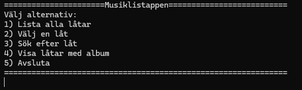

# Musiklistappen — Martin Bäcklund

---

## Vad appen gör

Det är en konsollapp i C# som hanterar några av Beatles musik ifrån en SQLite databas. I appen kan man lista alla låtar, välja en särskild låt via låtens id, söka på titel och visa alla låtar tillsamans med vilket album de ligger på.

## Så kör du den

```bash
git clone https://github.com/Martin-Backlund/martin-clo26-musiklistappen.git
cd martin-clo26-musiklistappen/MusikApp
dotnet run
```

"Databasen musik.db ligger redan i Musik.App/"

## Så ser huvudmenyn ut



---

## Mina designval (VG)

*Fyll i det här avsnittet om du siktar på VG. Annars kan du ta bort det.*

1. **Hur designade du din databas? Varför valde du just den strukturen?**

   Databasen har fem tabeller: artist,album,song,member och song_writer. En artist har flera album och ett album har flera låtar därför pekar album på artist och song på album med foreign keys. song_writer är en kopplingstabell eftersom att en låt kan ha flera låtskrivare och en medlem kjan ha skrivit fllera låtar. På så sätt lagras varje sak  bara en gång.

2. **Vilket SQL-krav valde du (JOIN eller subquery) och varför passade det din app?**

   Jag valde JOIN. Låtarna och albumen ligger i olika tabeller och i song finns bara album_id. För att kunna visa albumets namn bredvid låten behövde jag slå ihop song och album med JOIN album on song.album_id = album.id. Det passade bra eftersom att det är så min databas är uppbyggd.

3. **Vad skulle du gjort annorlunda om du byggde om den från scratch?**

   Jag skulle byta språk på tabell och kolumnnamn till engelska för att slippa förvirring. Jag skulle också lägga in en metod så utskriften av en låt endast sker på ett ställe i en metod för att undvika upprepning i koden.
